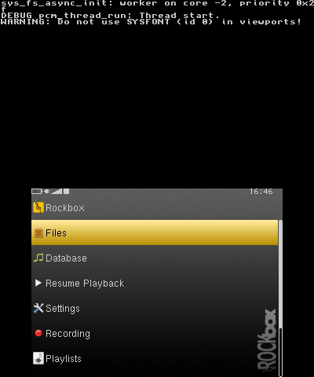
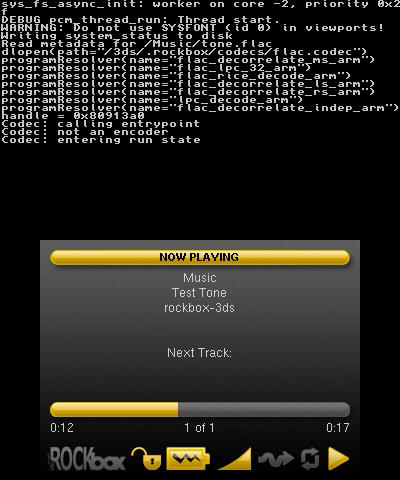

# rockbox-3ds

[Rockbox](https://www.rockbox.org) (open-source music player firmware) on the
**Nintendo 3DS** (Old 3DS / 2DS and New 3DS), as a homebrew `.3dsx` / `.cia`.

**Important finding:** upstream Rockbox already contains a 3DS port
(configure target `3ds`, "290) 3DS (WIP)", by Mauricio Garrido, merged
2025; sources in `firmware/target/hosted/game_console/3ds` and
`packaging/3ds`). So this repository does **not** re-implement a port. It is:

- upstream Rockbox pinned as a git submodule (`rockbox/`, currently `0ee9d424f9`),
- a reproducible, root-less toolchain setup (devkitARM, libctru, citro2d/3d,
  CTRL, CTRDL, makerom, bannertool) that works without pacman or docker,
- build and emulator-test scripts,
- a place for our own patches (`patches/`, applied on top of the submodule;
  none yet) and notes for future work (see [docs/DESIGN.md](docs/DESIGN.md)).

## Status

| | |
|---|---|
| Builds `rockbox.3dsx`, `rockbox.cia`, `rockbox-full.zip` (codecs, plugins, themes) | yes, unmodified upstream |
| Boots to main menu in Azahar 2126.2 | verified ([screenshot](docs/main-menu.png)) |
| Buttons (D-pad, A) navigate the file browser | verified in Azahar |
| FLAC playback through ndsp (codec loaded from SD via CTRDL) | verified in Azahar: progress bar advances, non-silent audio in the emulator's A/V dump ([screenshot](docs/now-playing.png)) |
| Real hardware (Old 3DS) | **not tested** |
| Other codecs, plugins, recording, touch, sleep/lid, CIA install | **not tested** |

 

(Top screen shows upstream's debug console; the bottom screen is the Rockbox UI.)

## Build (Linux x86_64, no root)

    git clone --recursive https://github.com/devilAPI/rockbox-3ds
    cd rockbox-3ds
    scripts/setup-toolchain.sh   # ~600 MB under build/toolchain
    scripts/build.sh             # -> build/rockbox-3ds/rockbox-full.zip

Needs: bash, curl, git, python3, cmake, make, a host gcc, perl, zip.

## Install on a 3DS

Extract `rockbox-full.zip` to the root of the SD card (it creates
`/3ds/.rockbox/`), then start `/3ds/.rockbox/rockbox.3dsx` from the Homebrew
Launcher, or install `/3ds/rockbox.cia`. Audio needs `sdmc:/3ds/dspfirm.cdc`;
Rockbox tries to dump it from your own console on first start (or use the
"DSP1" homebrew). That file is Nintendo's and is not distributed here.

## Test in an emulator

    scripts/run-emulator.sh                 # downloads Azahar into build/emu
    NESTED=1 DUMP=/tmp/out.mkv scripts/run-emulator.sh &   # scripted, in Xephyr
    scripts/emu-keys.py a down a a          # Files -> Music -> tone.flac

## License

Rockbox is GPL-2.0-or-later; so is everything in this repository
(see [LICENSE](LICENSE)). No Nintendo binaries or keys are included.
